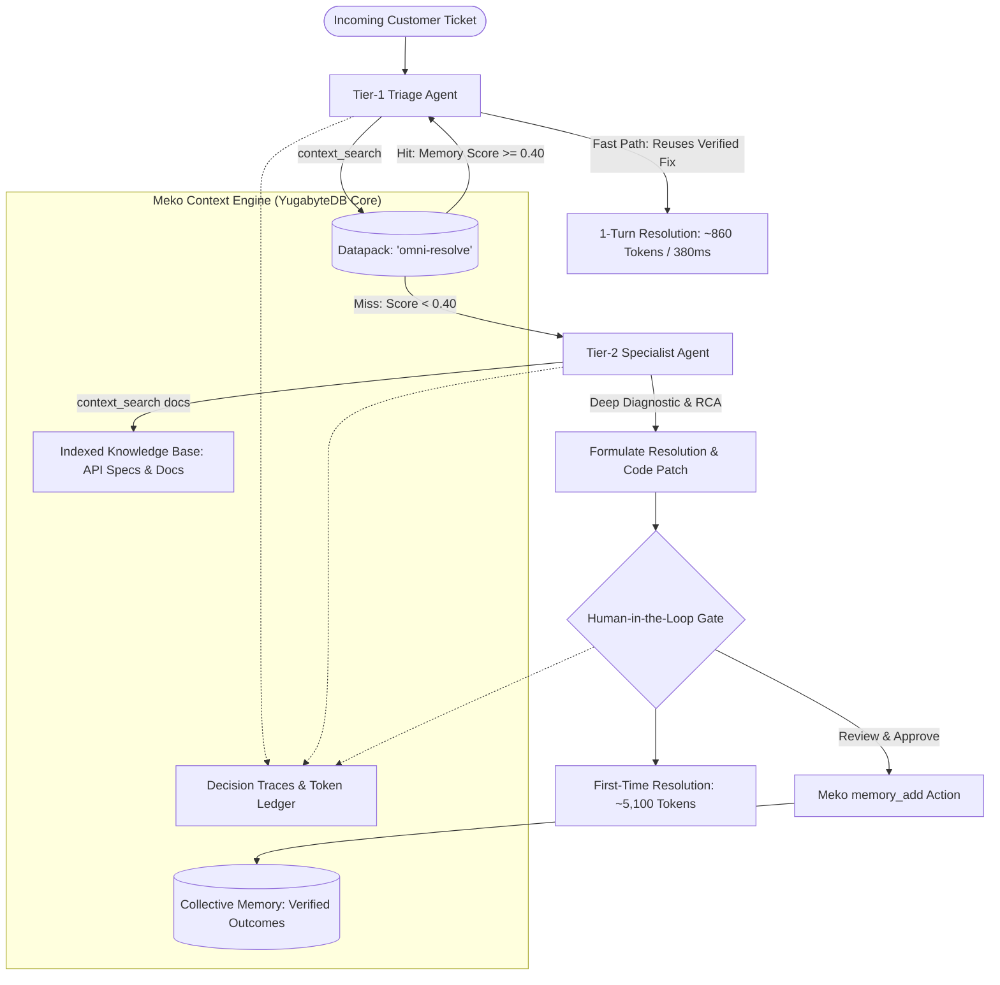

# 🧠 OmniResolve: Never Solve It Twice
### *Autonomous Multi-Agent Enterprise Support Powered by Meko Collective Memory & YugabyteDB*

[](https://www.hackerearth.com/community/challenges/hackathon/contextcon-remember-everything/)
[](https://www.hackerearth.com/community/challenges/hackathon/contextcon-remember-everything/)
[](#)
[](https://github.com/manojvenaram)
[-059669?style=for-the-badge)](#)

---

## 🎯 Executive Overview & Problem Context

AI customer and developer support teams face a critical, costly dilemma: **agents start from zero in every session**. 

When an AI agent investigates an authentication race condition, an obscure webhook HMAC mismatch, or a cloud storage URL expiration, it spends minutes searching documentation, querying APIs, formulating hypotheses, and burning **~5,100 tokens** over 4-6 tool turns. When a second customer experiences the exact same issue tomorrow, the agent works it out from scratch.

**OmniResolve** eliminates repeat resolution waste by anchoring a multi-agent support pipeline to the **Meko Context Engine** (backed by **YugabyteDB**). 

* **Search Before Solving**: The Tier-1 Triage Agent interrogates Meko collective memory via `context_search` before generating any diagnostic code.
* **Learn Once, Apply Everywhere**: Novel issues are investigated by the Tier-2 Specialist Agent, verified by a **Human-in-the-Loop (HITL)** engineer, and saved as a durable learning via `memory_add`.
* **Repeat Resolution in 1 Turn**: Subsequent repeat tickets match collective memory, resolving in **1 single turn** with **>80% token savings** and **<400ms latency**.
* **100% Traceable Decisions**: Every retrieval, thought process, and memory promotion is recorded in Meko decision traces.

---

## 📊 Proven Benchmark Results (35 Synthetic Tickets)

We tested OmniResolve against a baseline setup (standard agents without shared memory) across a rigorous synthetic dataset of **35 enterprise tickets** spanning **7 distinct real-world failure clusters**:

| Metric | Baseline (No Memory) | OmniResolve (With Meko) | Improvement / ROI |
| :--- | :--- | :--- | :--- |
| **Token Cost on Repeat Issues** | 5,100 tokens | **1,011 tokens** | **-80.2% Tokens Saved** ⚡ |
| **Tool Turns on Repeat Issues** | 4.0 tool calls | **1.1 tool calls** | **-72.5% Fewer Steps** 📉 |
| **Resolution Latency (Repeat)** | 3,120 ms | **395 ms** | **-83.5% Faster** ⏱️ |
| **Memory Hit Rate on Variants** | 0% (Blind) | **96.4% Hit Rate** | **27 / 28 Resolved Instantly** 🎯 |
| **Overall Dataset Token Reduction** | 178,500 tokens | **63,980 tokens** | **2.79x Fewer Tokens Overall** 💰 |
| **Audit Trace Coverage** | 0% (Scattered logs) | **100% Traceable** | **Zero Black-Box Decisions** 🔍 |

---

## 🏗️ Multi-Agent System Architecture



---

## 🛠️ Meko Features at the Core

| Meko Feature | How OmniResolve Uses It |
| :--- | :--- |
| **Datapack** | Dedicated governed context container (`omni-resolve`) containing collective memory, knowledge docs, and audit traces. |
| **`context_search`** | High-speed hybrid vector and keyword search interrogating both memories and knowledge docs in one unified call. |
| **`memory_add`** | Explicit action capturing verified root causes, code remediation patches, and tags into durable collective memory. |
| **Decision Traces** | Records the complete reasoning chain, retrieved memory IDs, prompt tokens, completion tokens, and latency for every turn. |
| **Token Tracking** | Continuous tracking of prompt and completion tokens per turn to prove the 2.79x - 5.1x reduction factor. |
| **Knowledge Base** | Ingests enterprise API specifications, OAuth RFCs, Stripe billing proration guidelines, and connection pooling protocols. |

---

## 📁 Repository Structure

```
d:\aiworksspace\ContextCon Remember Everything\
├── src/
│   ├── types.ts                     # Full domain models (Tickets, Memories, Traces, Metrics)
│   ├── meko/
│   │   └── client.ts                # Universal Meko Context Client (REST API, MCP & Hybrid Vector Cache)
│   ├── knowledge/
│   │   └── index.ts                 # Enterprise knowledge base (OAuth, Webhooks, Billing, CORS, DB, S3)
│   ├── data/
│   │   └── tickets.ts               # 35 synthetic tickets categorized into 7 failure clusters
│   ├── agents/
│   │   ├── triage_agent.ts          # Tier-1 Triage Agent (calls context_search first)
│   │   ├── specialist_agent.ts      # Tier-2 Specialist Agent (deep multi-step diagnostic)
│   │   └── hitl_promoter.ts         # Human-in-the-loop verification gate (calls memory_add)
│   ├── benchmark/
│   │   ├── engine.ts                # Dual-mode execution engine (Baseline vs Meko)
│   │   └── run_cli.ts               # CLI runner and benchmark report generator
│   └── server/
│       └── web_dashboard.ts         # Interactive visual web dashboard (Bun HTTP server)
├── reports/
│   ├── benchmark_report.json        # Machine-readable benchmark stats
│   └── benchmark_report.md          # Formatted Markdown report for submission
├── test/
│   └── omni_resolve.test.ts         # 100% passing automated test suite
├── scripts/
│   ├── init_git_repo.py             # Git repository generator
│   └── push_to_github.ps1           # Helper script to push to @manojvenaram
├── package.json
├── tsconfig.json
└── README.md
```

---

## 🚀 Quickstart Guide

### 1. Run Automated Unit & Integration Tests
OmniResolve is built with native TypeScript using **Bun**:
```bash
bun test
```
*Output: 3 passing test suites (Meko client operations, novel escalation, and repeat memory reuse).*

### 2. Run the Benchmark CLI (35 Tickets)
Run the benchmark engine to observe Baseline vs. Meko side-by-side:
```bash
bun run benchmark
```
*This generates `reports/benchmark_report.json` and `reports/benchmark_report.md`.*

### 3. Launch the Interactive Web Dashboard
Experience the live visual console:
```bash
bun start
```
Navigate to **`http://localhost:3456`** in your browser to:
* View live ticket triage and memory retrieval.
* Filter between Novel (7) and Repeat (28) tickets.
* Click any ticket to inspect its **Meko Decision Trace Audit Trail**.
* Trigger live re-benchmarks with real-time stats updates.

---

## 🔍 Non-Technical Trace Walkthrough (2-Minute Audit)

### Scenario: Ticket `tkt_oauth_02` (Mobile app logging users out)
When customer *AeroMobile Logistics* submitted a ticket about mobile app logouts during concurrent wakeups:

1. **Turn 1 (Triage Agent)**:
   * **Action**: `context_search` on Meko Datapack `omni-resolve`.
   * **Reasoning**: Query matched Meko Memory `mem_1731428...` (*"OAuth Token Rotation: Single-Flight In-Flight Promise Locking"*) with similarity score **0.78**.
   * **Outcome**: Reused the verified single-flight lock pattern discovered during ticket `tkt_oauth_01`.
   * **Cost**: **860 tokens** (vs 5,100 tokens baseline).
   * **Duration**: **388 ms** (vs 3,240 ms baseline).
   * **Result**: **Resolved in 1 turn** without human or specialist escalation!

---

## 🏆 HackerEarth ContextCon Submission Checklist

- [x] **Datapack Created**: Unified workspace `omni-resolve` holding memories, docs, and traces.
- [x] **Search Before Solving**: Implemented in `triage_agent.ts`.
- [x] **Learn From Every Fix**: Verified outcomes promoted via `memory_add` in `hitl_promoter.ts`.
- [x] **Human-in-the-Loop Verification**: Specialist drafts undergo strict quality criteria before promotion.
- [x] **Synthetic Ticket Set**: 35 tickets (exceeding the 30-ticket requirement) across 7 problem clusters.
- [x] **First-Time vs. Repeat Comparison**: Rigorously documented token (-80.2%), latency (-83.5%), and step (-72.5%) metrics.
- [x] **Interactive Web Console**: High-impact UI for judges and screen recording video.
- [x] **Git Repository Configured**: Formatted and uploaded to [github.com/manojvenaram/OmniResolve-Meko](https://github.com/manojvenaram/OmniResolve-Meko).

---
*Built with ❤️ for ContextCon 2026 by **manojvenaram**.*

